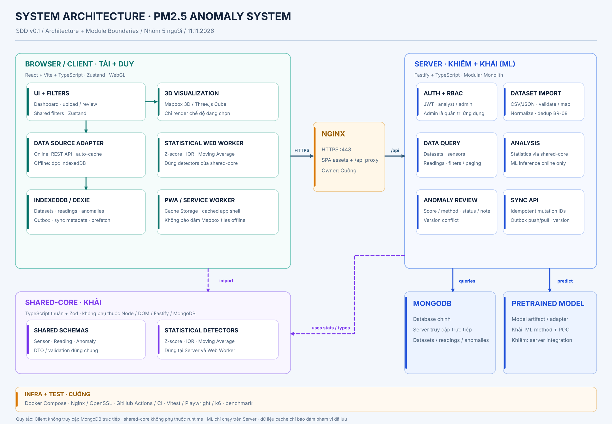
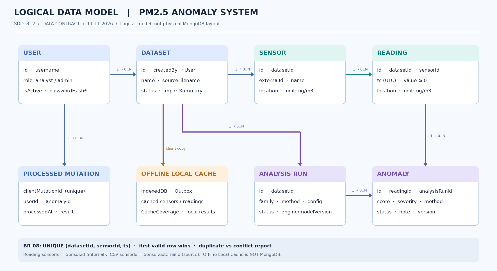

# SDD v0.4 — Kiến trúc, dữ liệu dùng chung, API Contract và MongoDB vật lý

**Đề tài:** Xây dựng hệ thống phân tích và phát hiện bất thường trong dữ liệu không gian – thời gian bằng trực quan 3D  
**Phạm vi tài liệu:** **Bước 1–3** — System Architecture, Module Boundary, Logical Data Model, Shared Data Contract, API Contract và MongoDB Physical Design  
**Cơ sở yêu cầu:** `docs/SRS.md` v0.5 (12/11/2026) và `KE_HOACH_DO_AN_THONG_NHAT_NHOM_5_NGUOI.md` (11/11/2026).  
**Trạng thái:** Thiết kế khởi động để phân công và bắt đầu code độc lập. **Đã chốt định hướng Backend/Frontend và phân luồng Mapbox; API/DB v0.3 vẫn là bản draft cần review, chưa phải SDD cuối cùng.**

> **Quy tắc đọc:** Phần này chốt trách nhiệm và hướng phụ thuộc giữa các module. Không tự suy diễn thành API/DTO, index MongoDB hay chi tiết class đã được chốt. Hợp đồng dữ liệu ở Bước 2 là bản khởi đầu; REST API/HTTP và MongoDB vật lý có bản thiết kế ở Bước 3 bên dưới, hiện chưa khóa các quyết định mở.

## 1. Architecture Overview



**Bản gốc có thể chỉnh sửa:** [`diagrams/system-architecture.drawio`](diagrams/system-architecture.drawio).

> **Lưu ý đồng bộ sơ đồ:** Hình ở trên là bản v0.1 thể hiện các khối chính. Các quyết định bổ sung trong mục 1.1–1.4 (file-based routing, tầng module, Mapbox là dịch vụ ngoài đi thẳng từ Browser) được mô tả bằng văn bản ở v0.4; cần cập nhật `.drawio`/`.png` trong lần đồng bộ sơ đồ kế tiếp, tránh coi hình cũ là đầy đủ.

### 1.1. Phong cách kiến trúc

- **Backend đã chốt:** **Fastify + TypeScript**, kiến trúc **Feature-based Modular Monolith**, trong mỗi feature áp dụng **Layered Architecture**: `Route → Validation → Service → Repository → MongoDB`. Dùng Fastify plugin/encapsulation và dependency injection tối giản qua factory/constructor; **không dùng NestJS** và không tự xây DI container, event bus hay CQRS cho MVP.
- **Frontend đã chốt:** **React + Vite + TypeScript**, **Feature-based Modular Frontend Architecture** kết hợp **TanStack Router (file-based routing)**. File trong `routes/` chủ yếu khai báo route và lắp ghép page; logic/dữ liệu thuộc `features/`, phần offline thuộc `offline/`, tiện ích chung thuộc `shared/`. **Mapbox 3D** và **Three.js Space–Time Cube** là hai chế độ hiển thị thay phiên nhau, dùng cùng bộ lọc/dataset/anomaly; tránh duy trì hai render loop nặng đồng thời.
- **Nguồn dữ liệu nghiệp vụ:** MongoDB chỉ do **Fastify Backend** truy cập; Browser đọc/ghi thông qua HTTPS REST API của ứng dụng hoặc bản sao cục bộ trong IndexedDB. **Riêng bản đồ nền Mapbox**: Browser dùng **public access token `pk.`** để gọi trực tiếp Mapbox-hosted APIs lấy styles/tiles/glyphs; **không định tuyến qua Fastify** và không cần Mapbox token tại Backend cho luồng bản đồ thông thường.
- **Offline-first ưu tiên khôi phục:** dữ liệu đã nhận online được **tự động lưu** để dùng offline, đồng thời lưu **ngữ cảnh làm việc cần khôi phục** (dataset, bộ lọc, khoảng thời gian, chế độ xem, camera khi phù hợp). App shell dùng PWA/Cache Storage; dữ liệu nghiệp vụ/ngữ cảnh/outbox dùng IndexedDB/Dexie. Mất mạng không được làm mất mutation đã lưu; tải trước dữ liệu lớn hơn chỉ là tùy chọn.
- **Algorithm core dùng chung:** `shared-core` viết TypeScript thuần, chứa Zod schema và thuật toán thống kê; dùng tại Backend và trong Client Web Worker. **ML inference chỉ ở Server** với model đã huấn luyện trước.
- **Môi trường triển khai:** Nginx kết thúc TLS ở HTTPS `:443`, phân phối tài nguyên Client và reverse proxy các request `/api` tới Fastify; Docker Compose dùng để dựng môi trường demo/test.

### 1.2. Hai tuyến thực thi cơ bản

**Online — dữ liệu nghiệp vụ:** Browser → Nginx HTTPS (`/api/v1`) → Fastify → MongoDB. Analysis (statistical/ml) tiếp nhận bền vững rồi trả `202 {data: AnalysisRun}`; cơ chế thực thi nền Server chạy engine với concurrency giới hạn, lưu kết quả rồi công bố completed. Browser đọc `GET /api/v1/analysis-runs/{id}` và tải anomalies phân trang sau completed. Các luồng auto-cache/offline giữ thiết kế riêng, không nằm trong đợt frontend online này.

**Online — nền bản đồ:** Browser (Mapbox GL JS + `pk.` token) **→ Mapbox Servers trực tiếp** để tải style/tiles/glyphs; Mapbox GL JS render trên GPU Client. Fastify không chuyển tiếp dữ liệu nền và không giữ token này.

**Offline:** Browser → `dataSource`/session restoration → IndexedDB; thống kê chạy qua **Browser Web Worker** + `shared-core`. Chỉnh `status/note` anomaly đã tồn tại trên Server phải ghi outbox bền vững trước khi báo đã lưu cục bộ; khi Backend thực sự phản hồi, push/pull với `clientMutationId`/`baseVersion`, cập nhật trạng thái đã đồng bộ hoặc xung đột.

> Bản đồ nền Mapbox và hình học tòa nhà có thể cần mạng; SRS không cam kết tile 3D đầy đủ khi offline. **Có thể khôi phục camera/bộ lọc nhưng không bảo đảm tile/tòa nhà có sẵn**. Offline phải giữ khả năng xem dữ liệu đã lưu bằng renderer/giao diện phù hợp (ví dụ bảng/biểu đồ/Space–Time Cube) mà không phụ thuộc nền Mapbox.

### 1.3. Mapbox Public Token và phạm vi tính tải

- `client/` khai báo biến môi trường Vite `VITE_MAPBOX_TOKEN=pk....` tại thời điểm build/chạy theo cấu hình; **biến `VITE_` đi vào bundle và công khai với Client**, không phải kho chứa bí mật. Chỉ dùng public token, quyền tối thiểu và cấu hình giới hạn URL/origin phù hợp. Không đưa secret token `sk.` vào Frontend.
- Nhiều Client có thể dùng chung public token thuộc **tài khoản Mapbox của nhóm**; sử dụng được ghi nhận về tài khoản, không quản lý một token/người dùng. Backend JWT dành cho API nghiệp vụ là cơ chế **khác**.
- Trình duyệt tạo một Mapbox instance khi vào chế độ bản đồ và cần tránh khởi tạo lặp không cần thiết; chi phí/tải Mapbox phụ thuộc cơ chế tính phí dịch vụ tại thời điểm triển khai. **Không làm giả định chi phí hay availability trong SDD**.
- Frontend gọi hai nguồn dữ liệu độc lập: `Mapbox` (nền bản đồ) và `Fastify /api` (PM2.5/anomalies). Khi mất kết nối, chỉ phần dữ liệu đã ghi bền vững được cam kết offline; Mapbox không được xem là nguồn dữ liệu PM2.5.

### 1.4. ML inference và phân biệt Worker

- **Đã chốt:** ML inference dùng model đã huấn luyện trước và **chạy phía Server**; không chạy trên trình duyệt mỗi người dùng. **Browser Web Worker** (Duy/Khải) chỉ xử lý thống kê offline.
- **Đã chốt hướng OPEN-06 — D008 (13/11/2026):** Analysis online dùng job `queued/running/completed/failed` cho cả statistical/ml, tiếp nhận và thực thi tách rời. Worker/cơ chế nền thuộc Server, giới hạn concurrency; công nghệ queue và process/thread topology, recovery/retention và mức tải còn cần owner chốt. Không mặc định Redis/BullMQ/Kafka/Spark.
- Worker vẫn dùng CPU/RAM Server; async không phải bằng chứng giảm tài nguyên hoặc hệ thống cũ quá tải. `POST /api/v1/analysis-runs` trả 202 tiếp nhận, không anomalies; GET detail/history dùng cùng DTO. Completed chỉ sau persist đầy đủ. Chi tiết [D008](decisions.md#d008--analysis-online-bất-đồng-bộ). Upload/Import giữ đồng bộ.

## 2. Module Boundary & Responsibility

| Module / vị trí | Owner chính | Có trách nhiệm | Không có trách nhiệm |
|---|---|---|---|
| **`client/` — UI & 3D** | **Tài (Người 2)** | React dashboard, **TanStack Router file-based routes**, `features/`, bộ lọc chung (Zustand), màn hình upload/review, Mapbox 3D, Three.js Cube, trạng thái giao diện và camera cần khôi phục (phối hợp Duy) | Kết nối MongoDB, triển khai retry/sync trong component, viết lại thuật toán thống kê, inference ML |
| **`client/` — Offline & Data Source** | **Duy (Người 3)** | PWA/Service Worker, Cache Storage app shell, Dexie/IndexedDB, **auto-cache dữ liệu**, lưu/khôi phục session state từ interface với Tài, prefetch tùy chọn, `dataSource`, durable outbox, connectivity, sync, Browser Web Worker | Vẽ renderer 3D, tự sửa API Contract, xử lý ML offline, upload/import hoàn chỉnh offline |
| **`server/` — API & Database** | **Khiêm (Người 1)** | Fastify **feature modules với Route → Validation → Service → Repository**, JWT 2 role (`analyst`/`admin`), tài khoản, CSV/JSON parse/validate/mapping/import, BR-08 dedup, query, MongoDB, API analysis/anomaly/sync, error handling | Triển khai NestJS hay DI framework tự chế; render Mapbox/Three.js; quản trị hạ tầng qua JWT role |
| **`shared-core/` — Schema & Statistics** | **Khải (Người 4)** | Shared DTO/Zod, Z-score, IQR, Moving Average, unit test, cùng một định nghĩa thuật toán tại Server/Worker | Import Fastify/MongoDB/DOM/Node-only API; xử lý UI, lưu trữ trực tiếp |
| **`server/` — ML module** | **Khải (thuật toán) + Khiêm (tích hợp)** | Train ngoài request, lưu model, kiểm chứng `train → save → load → predict`; server-side inference adapter và metadata method/version/score | Inference mới khi offline, train tự động khi upload; đồng nhất kết quả ML với kết quả thống kê |
| **`infra/` và `tests/`** | **Cường (Người 5)** | Docker Compose, Nginx HTTPS `:443`, chứng chỉ dev (OpenSSL), pipeline CI, setup test/fixture, k6, tổng hợp coverage/performance | Thay đổi nghiệp vụ/DTO/API của người khác mà không thảo luận; coi DevOps là JWT `admin` |

**Lưu ý:** Các thư mục con trong bảng là phạm vi sở hữu logic. Trừ các gốc thư mục Monorepo đã có, **chưa khẳng định mọi thư mục con/file đều đã được tạo**; mỗi owner tạo theo nhiệm vụ và giữ đúng ranh giới.

### 2.1. Quyền quyết định và vùng cần phối hợp

- **Khiêm sở hữu API Contract và persistence mapping.** Việc đổi shape request/response, auth, dữ liệu truy xuất, import/sync phải được thông báo cho Tài, Duy, Khải trước khi merge.
- **Khải sở hữu schema cốt lõi và chữ ký detector** nhưng cần review cùng Khiêm trước khi đổi field dùng qua API; schema ở `shared-core` **không phải** MongoDB document vật lý.
- **Duy sở hữu `dataSource` và lifecycle đồng bộ**; Tài chỉ đọc/ghi thông qua interface được thống nhất, không trực tiếp truy cập Dexie/outbox bên trong renderer.
- **Tài sở hữu trải nghiệm 3D/UI:** cách dựng scene, điều khiển camera, component, clustering/LOD nội bộ không cần nhóm trưởng duyệt nếu không đổi hợp đồng hoặc nghiệp vụ.
- **Cường sở hữu triển khai và kiểm thử hạ tầng** nhưng yêu cầu cấu hình runtime (port, `health`, env, build) cần phối hợp với owner ứng dụng.

## 3. Quy tắc phụ thuộc bắt buộc

| Từ | Được phép phụ thuộc | Không được phép |
|---|---|---|
| Client UI / 3D | `dataSource` của Duy, UI state, shared public types; **Mapbox GL JS gọi Mapbox-hosted APIs trực tiếp bằng public token** | MongoDB trực tiếp; gọi `/api` tùy tiện trong renderer; xử lý outbox/sync trong component bản đồ; lưu secret Mapbox token |
| Client Offline / Data Source | API qua Nginx, IndexedDB/Dexie, Cache Storage, Worker, public schemas | Logic và state nội bộ riêng của Mapbox/Cube; gọi ML inference khi offline |
| Client Web Worker | Statistical detectors, kiểu dữ liệu thuộc `shared-core` | Fastify, MongoDB, DOM/window, model ML trên Server |
| Backend Fastify | MongoDB driver/ODM (còn mở lựa chọn), `shared-core`, server ML adapter, HTTP APIs; module route/service/repository theo public interface | Import module/DOM/Worker của Browser; feature tự truy cập repository nội bộ của feature khác; phụ thuộc ngược service vào route |
| `shared-core` | TypeScript thuần, Zod và tiện ích không phụ thuộc runtime | Fastify, MongoDB, `window`, `document`, Service Worker, Node-only API |
| Infra | Build/start/health của Client và Server, file cấu hình | Truy cập nghiệp vụ thông qua role Server Administrator giả định trong JWT |

**Điểm tích hợp không thể tùy ý thay đổi:**

1. **Giao tiếp Client ↔ Server:** HTTPS REST API, JSON và upload multipart theo API Contract riêng; frontend không phụ thuộc cấu trúc MongoDB thực.
2. **Dữ liệu trạm / readings:** vị trí WGS84, kinh-vĩ độ có thứ tự rõ; timestamp chuẩn UTC; giá trị PM2.5 chuẩn `µg/m³` (SRS BR-01–BR-06).
3. **Nhập dữ liệu trùng:** với một dataset và `(sensorId, timestamp)`, giữ bản ghi hợp lệ đầu tiên; phần trùng và xung đột được báo cáo, không ghi đè (BR-08).
4. **Kết quả phát hiện:** thống kê và ML là nguồn riêng, truy vết được method/analysis run; trạng thái review là `open / confirmed / false_positive` (BR-09–BR-13).
5. **Sync:** mutation có `clientMutationId`, cập nhật anomaly theo `baseVersion`; Server chống áp dụng trùng và báo conflict, không ghi đè âm thầm (BR-15–BR-18).
6. **Auto-cache + session restoration:** dữ liệu đã tải online phải tự lưu cục bộ nếu có thể; lưu ngữ cảnh làm việc cần khôi phục; chỉ coi là offline-ready khi lưu thành công; không mặc định toàn bộ dataset đã cache (BR-20–BR-23).
7. **Outbox an toàn:** mutation ghi bền vững trước khi báo lưu cục bộ; chỉ báo đồng bộ khi Server xác nhận; lỗi/conflict được giữ để xử lý (BR-16–BR-17, BR-24).
8. **Tổ chức module:** `routes/` của TanStack Router chỉ ghép trang; feature expose public API. Fastify `Route → Validation → Service → Repository`; không truy cập cross-feature internal repositories.
9. **RBAC:** chỉ có `analyst` và `admin` ở tầng ứng dụng. `admin` là **Application Admin**, không phải account quản trị Nginx/Docker/OS.

## 4. Giao tiếp giữa các module (đủ cho khởi động)

| Bên gửi | Bên nhận | Dữ liệu/điều kiện trao đổi | Ai định nghĩa hợp đồng |
|---|---|---|---|
| UI / renderer | `dataSource` | Bộ lọc dataset, trạm, vùng, thời gian; đọc sensors/readings/anomalies; gửi review | **Duy + Tài**, thống nhất types với Khải |
| `dataSource` | Backend API | Auth; datasets; sensors/readings; analysis; anomalies; export/sync | **Khiêm**, review với Duy/Tài |
| `dataSource` | IndexedDB | Dữ liệu đã tải, trạng thái offline-ready, outbox, sync metadata | **Duy**, tuân shared types |
| UI / session state | Offline session repository | Dataset, trạm/vùng, bộ lọc, khoảng thời gian, chế độ xem, camera (nếu có); khôi phục sau reload/offline | **Tài + Duy**, thống nhất shape và thời điểm ghi |
| Browser Mapbox GL JS | Mapbox-hosted APIs | Public `pk.` token; bản đồ/styles/tiles/glyphs; **ngoài `/api` của Fastify** | **Tài**, quản lý token public và giới hạn domain phối hợp Cường |
| Web Worker | `shared-core` | Reading array + detector configuration → kết quả thống kê cục bộ | **Khải + Duy** |
| Backend | `shared-core` | Đầu vào và đầu ra thống kê nhất quán với offline | **Khải + Khiêm** |
| Backend | ML inference adapter | Feature input → predicted score/flag + model version | **Khải + Khiêm**, cần POC |
| Backend | MongoDB | Lưu dataset, sensor, reading, analysis run, anomaly, user, processed mutation | **Khiêm**, thiết kế dữ liệu logic Bước 2; DB vật lý tiếp theo |
| Nginx | Fastify | Reverse proxy `/api`, health, forwarding headers/timeout | **Cường + Khiêm** |

**Ghi chú lịch sử Bước 1:** Khi viết phần trên, contract chưa được thiết kế; nay xem **Bước 2** bên dưới và `shared-data-contract.md` cho DTO đề xuất. Vẫn chưa chốt chữ ký `dataSource`, REST request/response, mã HTTP, pagination và DB vật lý; không được xem bảng trên là API Contract chính thức.

## 5. Nơi lưu mã nguồn và tài liệu

```text
project-root/                           # Monorepo đã dựng
├── client/                             # Tài + Duy
├── server/                             # Khiêm; Khải cộng tác ML
├── shared-core/                        # Khải
├── infra/                              # Cường
├── tests/                              # Cường + các owner module
└── docs/
    ├── SRS.md                          # SRS v0.5
    ├── SDD.md                          # Tài liệu này
    ├── diagrams/
    │   ├── system-architecture.drawio  # Bản nguồn, mở bằng draw.io
    │   └── system-architecture.png     # Xem nhanh trên GitHub
    ├── api/                             # OpenAPI sau bước API Contract
    ├── ownership.md                     # Đã có; sửa nếu phân công thay đổi
    └── decisions.md                     # Đã có; ghi kiến trúc đã chốt
```

**Định hướng thư mục triển khai (đã thống nhất, chưa khẳng định đã scaffold):** `server/src/modules/<feature>/{*.routes.ts,*.schema.ts,*.service.ts,*.repository.ts,index.ts}`; `server/src/plugins/` dành cho Fastify infrastructure. `client/src/routes/` chứa TanStack file-based routes; `client/src/features/` chứa feature modules; `client/src/offline/` chứa data-source, Dexie, sync, workers; `client/src/shared/` chứa API client/UI tiện ích. Không đưa toàn bộ business logic vào route file hoặc root React component.

**Quy tắc tài liệu:** Cùng một quyết định kỹ thuật chỉ có một nơi quản lý chính. `SDD.md` mô tả thiết kế; `ownership.md` ghi phân công; `decisions.md` ghi quyết định/thay đổi; OpenAPI là hợp đồng HTTP cuối cùng. Không nhân đôi và để mâu thuẫn giữa các nguồn.

## 6. Tiêu chí hoàn thành bước 1 và công việc có thể bắt đầu

| Người | Có thể triển khai ngay sau SDD v0.1 | Chờ bước 2/3 trước khi tích hợp thật |
|---|---|---|
| **Tài** | React/Vite, Zustand filters, Mapbox với trạm mock, Cube với điểm mock, chuyển hai chế độ | DTO thật, API đọc, chuẩn anomaly/review |
| **Duy** | Workbox/PWA, app shell, Dexie mock, `dataSource` interface bản nháp, Web Worker skeleton, auto-cache khi lấy mock | API export/sync, cursor, version conflict, shared schemas ổn định |
| **Khải** | Schema/Zod bản đầu, Z-score/IQR/Moving Average, unit tests, POC model ML độc lập | Chốt input/output của detector và model cho Backend |
| **Cường** | Docker Compose skeleton, Nginx HTTPS `:443`, CI/lint/test script cơ bản | Lệnh build/start/health/port do Client + Backend xác nhận |
| **Khiêm** | Fastify skeleton, health, cấu trúc module, MongoDB local, soạn thiết kế dữ liệu và API | Chốt DB logic → shared schemas → OpenAPI cho phần tích hợp |

**Ghi chú tiến trình:** Những công việc còn thiếu ở v0.2 (API Contract và MongoDB vật lý) hiện đã có bản thiết kế tại mục 10–11 của v0.3. Các luồng upload/import, analysis và offline sync cần tiếp tục được hiện thực hóa và kiểm thử theo hợp đồng; không cần chờ toàn bộ SDD trước khi khởi tạo ứng dụng.

## 7. Truy vết SRS → SDD v0.1

| SRS | Thiết kế kiến trúc liên quan |
|---|---|
| FR-01; BR-14 | Fastify Auth/RBAC, hai role; admin ứng dụng |
| FR-02–FR-05; BR-01–BR-08 | Backend datasets/import + MongoDB |
| FR-06; FR-09 | Backend query → `dataSource` → Mapbox/Cube |
| FR-07–FR-08; BR-09–BR-12 | `shared-core` thống kê + ML inference Server |
| FR-10; BR-13, BR-15 | Anomaly review, version check |
| FR-11–FR-12; BR-16–BR-18, BR-20–BR-24 | PWA, auto-cache, IndexedDB, Browser Worker, **session restoration**, durable outbox, sync |
| NFR-01–NFR-09 | Stack, phân ranh runtime, HTTPS, Docker, test/benchmark |


---

## 8. Logical Data Model — Bước 2



**Bản gốc để chỉnh sửa:** [`diagrams/logical-data-model.drawio`](diagrams/logical-data-model.drawio).  
**Đặc tả chi tiết / Source of truth:** [`shared-data-contract.md`](shared-data-contract.md).

**Các thực thể:** `User`, `Dataset`, `Sensor`, `Reading`, `AnalysisRun`, `Anomaly`, `ProcessedMutation`; `Offline Local Cache` là dữ liệu Client, **không phải** collection MongoDB. Các quan hệ, khóa logic và quy tắc BR-08 được mô tả trong `shared-data-contract.md`.

**Các điểm thiết kế cần giữ:**
- `externalId` là mã trạm trong file; `Sensor.id` là định danh nội bộ, Reading liên kết qua `sensorId = Sensor.id`.
- Dữ liệu chuẩn hóa có UTC ISO `Z`, GeoJSON `[longitude, latitude]`, đơn vị PM2.5 `ug/m3`.
- `(datasetId, sensorId, ts)` là khóa duy nhất logic của Reading trong dataset; giữ bản ghi hợp lệ đầu tiên, phân loại duplicate/conflict, không tự ghi đè.
- Một Reading có **0..N anomalies** qua các lần phân tích, mỗi Anomaly phải truy vết tới đúng AnalysisRun; `status/note/version` thuộc review.
- Không để `User.passwordHash` lộ qua API.

## 9. Shared Data Contract — Bước 2

| Thành phần | Sản phẩm |
|---|---|
| Bảng DTO/điều kiện hợp lệ và mapping dữ liệu | [`shared-data-contract.md`](shared-data-contract.md) |
| Zod + TypeScript schema dự thảo | [`../shared-core/src/contracts/schemas.ts`](../shared-core/src/contracts/schemas.ts) |
| Ví dụ JSON để Tài/Duy mock | [`fixtures/contract-example.json`](fixtures/contract-example.json) |

**Các hợp đồng dùng chung chính:** `UserPublic`, `Dataset`, `Sensor`, `Reading`, `AnalysisRun`, `Anomaly`, `ImportSummary`, `OfflineReviewMutation`, `CacheCoverage`, `StatisticalDetectorInput/Output`.

**Vì sao không thiết kế MongoDB trực tiếp trong contract?** DTO là dữ liệu giao tiếp giữa các module, có thể khác document được lưu: ví dụ một `Reading` được gửi cho renderer có `location` để đặt điểm trên bản đồ; Server có thể lưu trực tiếp hoặc giải quyết vị trí từ `Sensor` tùy chiến lược index. Quyết định lưu thế nào thuộc physical DB design.

### 9.1. Quyền sở hữu và quy trình chốt

- **Khiêm** duyệt quan hệ dữ liệu, quy tắc nhập trùng, khóa tham chiếu và persistence mapping; phối hợp Khải khóa schema trước khi công bố API.
- **Khải** triển khai/kiểm thử Zod schemas và các hàm detector dùng chính loại `Reading` này; không import API runtime riêng.
- **Tài** sử dụng fixture + shared public DTO để render 3D và màn hình review, không tự đặt tên field mới.
- **Duy** dùng DTO cho IndexedDB, auto-cache và Outbox; `baseVersion`/`clientMutationId` chống xung đột/trùng; cache chỉ cam kết phạm vi thực sự lưu.
- **Cường** dùng fixture này trong smoke/integration tests; test dữ liệu lỗi và trùng nhập.

**Các điểm chưa khóa:** timezone của dữ liệu nguồn thiếu offset; ML cụ thể/feature; ngưỡng severity; giới hạn upload; công nghệ thực thi nền Analysis, concurrency và recovery (hướng async đã chốt); **chu kỳ đo, nhịp batch và thời lượng dataset phụ thuộc dữ liệu thực**; quy tắc trạm cùng externalId khác tọa độ; trạng thái vòng đời Dataset/AnalysisRun là enum dự thảo. Chi tiết và thời điểm cần chốt ở mục G `shared-data-contract.md`.

**Kết quả Bước 2:** đủ để UI/Offline/Engine viết code với kiểu dữ liệu thống nhất và fixture; **chưa thay thế OpenAPI**, chưa quy định payload từng endpoint, status HTTP hay index MongoDB tối ưu.


## 10. API Contract — Bước 3 (draft)

**Nguồn máy đọc:** [`api/openapi.yaml`](api/openapi.yaml); cách dùng, trạng thái và các ngoại lệ: [`api/README.md`](api/README.md).

- Backend và Client trao đổi qua `/api/...`, bearer JWT, JSON camelCase, ID opaque, GeoJSON `[lon,lat]`, UTC `Z`.
- `POST /api/v1/auth/tokens`, `POST /api/v1/auth/register`, `GET /api/v1/health` public; các API nghiệp vụ chỉ `analyst/admin`; `/api/v1/admin/users` chỉ admin. Không còn viewer.
- Register bổ sung một handler trong module Auth và một trang `/register`: chỉ nhận username/password, tái sử dụng User, validation, password hashing và quy tắc username duy nhất của luồng tạo tài khoản; Server cố định role analyst, từ chối role do client gửi. Trùng username trả 409; thành công 201 trả UserPublic trong `{data}`, không token, FE chuyển về Login. Không đổi JWT/RBAC, MongoDB hay luồng Admin.
- Các nhóm chức năng: Auth, Import/Dataset, Sensor/Reading Query, Analysis/Anomaly, Export/Sync, Admin. Phân trang bounded với opaque cursor.
- BR-08 báo duplicate/conflict và giữ first valid row; BR-15 dùng baseVersion; BR-16 dùng clientMutationId và idempotent receipt.
- `GET /api/export` trả dữ liệu theo trang/phạm vi cho Duy cache, không có bảo đảm toàn dataset được tải chỉ bởi một trang.
- Analysis async: `POST /api/v1/analysis-runs` → 202; `GET /api/v1/analysis-runs/{id}` → 200; GET history và anomalies phân trang giữ lại. Không có cancel/retry-job endpoint hoặc progress %; retry tiếp nhận giữ key/payload. API Contract v0.3.0-draft chưa phải implementation.
- `POST /api/readings/bulk` đánh dấu `x-internal`; UI không trực tiếp gọi. `GET /api/readings/aggregate` P1.

**Quyền sở hữu:** Khiêm viết Backend/OpenAPI; Tài dùng API list/analysis/review; Duy dùng export/sync; Khải kiểm tra tương ứng `shared-core` và methods.

## 11. MongoDB Physical Database Design — Bước 3 (draft)

**Tài liệu:** [`mongodb-physical-design.md`](mongodb-physical-design.md).  
**Index script đề xuất:** [`../infra/mongo/indexes.js`](../infra/mongo/indexes.js).

- 7 collections: `users`, `datasets`, `sensors`, `readings`, `analysisRuns`, `anomalies`, `processedMutations`.
- ObjectId ở persistence, string opaque ở API; BSON Date trong DB → ISO Z ở API; GeoJSON `[lon,lat]`. Sensor/Reading/Anomaly tách riêng.
- Unique `(datasetId,externalId)` cho Sensor; `(datasetId,sensorId,ts)` cho Reading; `(analysisRunId,readingId)` cho Anomaly; `clientMutationId` cho sync receipt.
- `datasets.status` là **visibility gate** khi import theo batch; không dùng một transaction khổng lồ cho 500k readings.
- Sync mutation phải cập nhật anomaly và receipt **cùng transaction**; MongoDB triển khai theo replica-set (có thể single-node replica set khi demo) để hỗ trợ tính nguyên tử.
- `readings.location` và `anomalies.location` là snapshot từ Sensor để phục vụ filter/map; Backend giữ toàn vẹn khi import.
- Index là khởi tạo để benchmark; cần xác nhận bằng `explain('executionStats')`, không khẳng định performance đã đạt.

### 11.1. Những việc cần review trước khi merge thành chuẩn

1. Khiêm ↔ Tài: API envelopes, error codes, cursor pagination, trạng thái Dataset.
2. Khiêm ↔ Duy: Export page boundaries, cache coverage, sync conflict/receipt/checkpoint.
3. Khiêm ↔ Khải: Analysis output, severity, ML feature contract, schema enum.
4. Khiêm ↔ Cường: MongoDB replica-set/transactions, HTTPS routing, DB index script, CI integration tests.
5. OPEN-02/03/04/05/06/07 và NEW-01/02/03/04 vẫn **chưa chốt**; cập nhật SRS/SDD/Contract cùng lúc khi quyết định.

---

**Lịch sử phiên bản**

| Version | Ngày | Thay đổi |
|---|---|---|
| v0.1 | 11/11/2026 | Chốt kiến trúc tổng thể, trách nhiệm, luật phụ thuộc; chưa chốt DB/API chi tiết |
| v0.2 | 11/11/2026 | Bổ sung Logical Data Model, quy tắc tham chiếu/unique, Shared Data Contract, Zod starter và JSON fixture; API/DB vật lý chưa khóa |
| v0.3 | 11/11/2026 | Bổ sung OpenAPI v0.1 draft, MongoDB Physical Design, indexes.js và HTTP fixtures; chưa khóa quyết định mở |
| v0.4 | 12/11/2026 | Chốt Fastify feature-modular layered backend, React feature-modular + TanStack Router, Mapbox trực tiếp từ Client/public token, ưu tiên session restoration/offline outbox; giữ ML job/Server Worker và thông số dataset chưa chốt |
