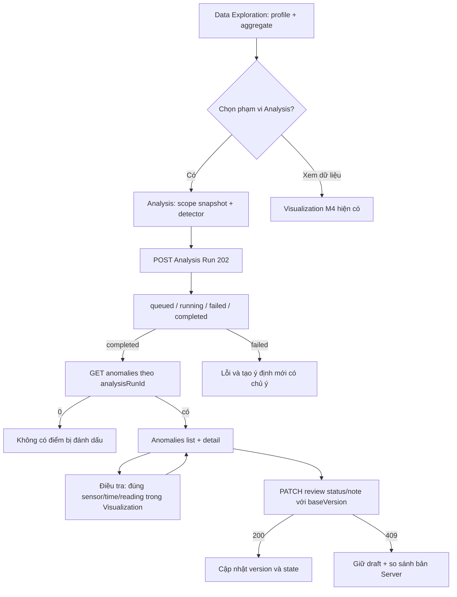

# PM2.5 Analyst Workspace — UX redesign handoff (v1)

**Phạm vi giao:** Data Exploration (Exploration/M4 data), Analysis (M5), Anomalies/Review (M6); chỉ **điều phối** sang Visualization (M4), không thiết kế lại Mapbox/Three.js/camera/cube/legend/heatmap.

**Nguồn:** Đọc trực tiếp nhánh [`khiem/backend-database`](https://github.com/khiemtrancong26-tech/spatiotemporal-anomaly-system/tree/khiem/backend-database) ngày 16/11/2026; đối chiếu file Word `UI_UX của hệ thống hiện tại.docx` do chủ dự án cung cấp và CSV `beijing-12-stations-demo-2015-03(2).csv`.

**Trạng thái tài liệu:** BẢN THIẾT KẾ/ĐẶC TẢ CHO CODEX; **chưa triển khai vào repo**. Các màn trong `mockups/` là **ảnh minh họa tĩnh**; dữ liệu đọc PM2.5 và phép tính Z-score minh họa đến từ CSV offline, không phải response Analysis Run trong phiên production. Run ID, review status, thời gian lịch sử được dựng cho minh họa, không phải dữ liệu online thực.

## 0. Quyết định sản phẩm không thay đổi

**North-star task:** Người dùng chọn và hiểu *phạm vi dữ liệu* → chạy một *detector* trên server → xem *điểm bị đánh dấu* → điều tra trong bối cảnh không gian–thời gian hiện có → ghi nhận *đánh giá của Analyst*.

| Khu vực | Câu hỏi chính | Kết quả người dùng thực sự cần |
|---|---|---|
| **Data Exploration** | Dataset có gì, độ tin cậy tới đâu, xu hướng của các trạm như thế nào? | Scope rõ ràng + biểu đồ tổng hợp đúng đơn vị + dữ liệu chất lượng được công khai |
| **Analysis** | Nếu chạy detector X trên phạm vi Y, Backend có phát hiện điểm nào đáng nghi? | Analysis Run có lifecycle, một danh sách các candidate anomalies gắn đúng run |
| **Anomalies** | Phát hiện này có đáng ghi nhận không? | Bối cảnh một anomaly + status/note do con người quyết định, lưu có kiểm soát phiên bản |
| **Visualization** | Điểm đó nằm ở đâu/khi nào và liên quan các điểm khác ra sao? | Mở **màn hình M4 hiện có** tại đúng reading/trạm/thời gian; không sửa render engine hoặc bố cục M4 |

**Cần tránh:** Biến Z-score/IQR thành biểu đồ báo cáo chỉ số, coi Isolation Forest là detector không gian–thời gian, coi severity `low` là ô nhiễm thấp, gọi mọi PM2.5 cao là anomaly, lấy 100 records FE làm detector input, nội suy bucket rỗng thành 0, trộn score giữa phương pháp, tự động retrain model bằng review, hoặc tự tạo endpoint mới.

## 1. Audit nguồn code / contract mới nhất

Các file cụ thể tại đúng branch:

- [`client/src/features/workspace/exploration.tsx`](https://github.com/khiemtrancong26-tech/spatiotemporal-anomaly-system/blob/khiem/backend-database/client/src/features/workspace/exploration.tsx): profile và time buckets hour/day; 20 station series; hiện dùng nhiều SVG dọc; copy kỹ thuật chiếm không gian.
- [`client/src/features/workspace/page.tsx`](https://github.com/khiemtrancong26-tech/spatiotemporal-anomaly-system/blob/khiem/backend-database/client/src/features/workspace/page.tsx): giữ 4 tabs, timezone, workspace filters; `profile` được fetch ở workspace; scope tra cứu không trùng scope của run cũ.
- [`client/src/features/analysis/page.tsx`](https://github.com/khiemtrancong26-tech/spatiotemporal-anomaly-system/blob/khiem/backend-database/client/src/features/analysis/page.tsx): POST 202, confirmation, idempotency snapshot, polling, history; hiện render `scope/config` dưới dạng JSON, khó hiểu.
- [`client/src/features/analysis/results.tsx`](https://github.com/khiemtrancong26-tech/spatiotemporal-anomaly-system/blob/khiem/backend-database/client/src/features/analysis/results.tsx): GET anomalies theo run completed, pager 100/tối đa hiển thị 2000; currently jump bằng `selectReadingId` có nguy cơ chưa được tải trong M4.
- [`client/src/features/anomalies/page.tsx`](https://github.com/khiemtrancong26-tech/spatiotemporal-anomaly-system/blob/khiem/backend-database/client/src/features/anomalies/page.tsx): list/detail/review/status/note/version conflict; hiện ID rất dài và bảng chiếm trang.
- [`client/src/features/workspace/state.ts`](https://github.com/khiemtrancong26-tech/spatiotemporal-anomaly-system/blob/khiem/backend-database/client/src/features/workspace/state.ts): `filters`, `tab`, `selectedReadingId`, `resultRun`, `anomalies`, `reviewDirty`, `timeZone`.
- [`client/src/app/styles.css`](https://github.com/khiemtrancong26-tech/spatiotemporal-anomaly-system/blob/khiem/backend-database/client/src/app/styles.css): hiện đã có token light UI; **kế thừa**, không thiết lập design language mới.
- [`server/src/modules/exploration/exploration.routes.ts`](https://github.com/khiemtrancong26-tech/spatiotemporal-anomaly-system/blob/khiem/backend-database/server/src/modules/exploration/exploration.routes.ts): `GET /api/v1/datasets/:id/profile`, `GET /api/v1/reading-aggregates` đã có implementation.
- [`server/src/modules/exploration/exploration.service.ts`](https://github.com/khiemtrancong26-tech/spatiotemporal-anomaly-system/blob/khiem/backend-database/server/src/modules/exploration/exploration.service.ts): profile scoped, sampling coverage unknown/known; aggregates bounded, không suy từ 2k render.
- [`server/src/modules/analysis/analysis.service.ts`](https://github.com/khiemtrancong26-tech/spatiotemporal-anomaly-system/blob/khiem/backend-database/server/src/modules/analysis/analysis.service.ts), [`analysis.repository.ts`](https://github.com/khiemtrancong26-tech/spatiotemporal-anomaly-system/blob/khiem/backend-database/server/src/modules/analysis/analysis.repository.ts): B5 async, selector sensorIds/from/to; đọc toàn bộ scope Server trong giới hạn 50k.
- [`server/src/modules/anomalies/anomalies.routes.ts`](https://github.com/khiemtrancong26-tech/spatiotemporal-anomaly-system/blob/khiem/backend-database/server/src/modules/anomalies/anomalies.routes.ts): B6 **đã triển khai** GET list, GET detail, PATCH review; không cần chờ làm B6.
- [`docs/backend/b6-verification.md`](https://github.com/khiemtrancong26-tech/spatiotemporal-anomaly-system/blob/khiem/backend-database/docs/backend/b6-verification.md): có kiểm thử API thật, CSV demo, CAS/conflict giữa hai client. **Không** suy từ đây rằng FPS/Mapbox/Cube đã nghiệm thu đầy đủ.

### 1.1 Ma trận API: hiện có vs không có

| Nhu cầu giao diện | Endpoint đã có | Giới hạn / chặn hiểu sai |
|---|---|---|
| Dataset profile + overall/scoped count, min/mean/max, coverage | GET `/datasets/:id/profile` | Nếu không có sampling metadata, coverage **unknown**; số readings trong response có thể là scope đang tra cứu, không đếm 2k render |
| Mean per station/time bucket | GET `/reading-aggregates` | hour/day; cần from/to; 20 series; 20.000 cells; max range hour 31 ngày/day 366 ngày; response 5 MiB, timeout 5s, 2 request concurrent mặc định |
| Sensor name/location | GET `/sensors` | phân trang 100 mặc định, max 200; bbox được hỗ trợ ở query sensors |
| Reading values | GET `/readings` | lọc datasetId, **một** sensorId, bbox/from/to, 100 mặc định, max 200; cursor keyset |
| Create run | POST `/analysis-runs` | returns `202 {data: AnalysisRun}` **queued**; không có anomaly trực tiếp trong response; `Idempotency-Key` |
| Run detail/history | GET `/analysis-runs/:id`, GET `/analysis-runs` | queued/running/completed/failed; no percentage progress/ETA; history 100, max 200 |
| Anomaly list | GET `/anomalies` | filter datasetId/runId/family/method/severity/status/from/to; **KHÔNG có sensorId/bbox filter**, không có total count |
| Anomaly detail | GET `/anomalies/:id` | có `readingId`, `sensorId`, `ts`, coordinates, `score`, `status`, etc.; **KHÔNG có `value` PM2.5** |
| Review | PATCH `/anomalies/:id` | chỉ `baseVersion`, `{changes:{status?,note?}}`; 409 version conflict, không tự ghi đè |

Không thiết kế `GET /reading/:id`, export, rerun/cancel, cancel job, “probability”, per-run count mới, trend forecast, spatial model hoặc đào tạo model online. Nếu phát sinh ý tưởng mới, phải tách ra Future Scope và chờ duyệt contract.

### 1.2 Limits không được gộp

- **100 records** = page size client thông thường; backend list có thể nhận 1..200.
- **2.000 readings** = ngân sách phiên render/truy vấn phía FE cho Cube/bảng; **không** phải giới hạn Analysis.
- **2.000 anomalies** = ngân sách tải kết quả trên phiên FE hiện tại; sau khi chạm cap và còn cursor phải nói rõ **chưa tải hết**, không tuyên bố total.
- **50.000 readings/run** = hard cap B5, quá mức phải failed rõ mã `SCOPE_LIMIT_EXCEEDED`, không cắt silently.
- **500.000 readings** = max Explorer profile/aggregates mặc định khác với Analysis cap; không khẳng định mọi profile <500k thành công vì còn timeout/response/cell/series limits.
- **Run Status** chỉ `queued`, `running`, `completed`, `failed`. Client đọc 3s khi visible, backoff tối đa 30s; rời UI không hủy server job.
- **ML hiện tại** Isolation Forest với feature duy nhất `PM2.5 value` do model offline học. Z-score và IQR grouping từng sensor; MA có ở Backend nhưng chưa thuộc 3 nút FE hiện tại, **không thêm vội**.

## 2. Layout/chủ đề visual (giữ vibe hiện tại)

### 2.1 Màu & font — dùng đúng đơn vị CSS px, HEX

| Token | Giá trị | Dùng cho |
|---|---|---|
| `--ux-bg` | `#F2F5F9` | Nền canvas workspace |
| `--ux-surface` | `#FFFFFF` | Panel/cards |
| `--ux-ink` | `#17283F` | Headings & nội dung chính |
| `--ux-muted` | `#5C6B80` | Labels, help text |
| `--ux-border` | `#DDE4EC` | Panel border/input separators |
| `--ux-primary` | `#2463D4` | CTA gửi phân tích, selected tabs |
| `--ux-primary-hover` | `#194FAB` | Hover CTA |
| `--ux-teal` | `#087E8B` | Nhấn brand/đường time-series trạm, không phải cảnh báo |
| `--ux-info-bg` | `#EDF3FF` | Giải thích, không mang nghĩa success |
| `--ux-success` | `#137A50` | Run completed và review confirmed ở góc trạng thái |
| `--ux-success-bg` | `#E7F6EF` | Nền status completed |
| `--ux-warning` | `#A56A1C` | Cảnh báo scope, uncertainty |
| `--ux-warning-bg` | `#FFF4E6` | Nền cảnh báo |
| `--ux-error` | `#BD4747` | failed/rejected/error |
| `--ux-error-bg` | `#FFF0F0` | Nền lỗi |
| `--ux-focus` | `#2463D4` | focus-visible outline 2px offset 2px |

- Font: `Inter`, fallback `Segoe UI`, `system-ui`; không tải font bên ngoài. Sử dụng sẵn stack hiện tại.
- Heading H1 workspace: **24px/32px, 700–750**. Heading H2 trong tab: **26px/32px, 700**. Card title: **17px/24px, 700**.
- Body: **14px/22px**; label: **12–13px/18px**, semibold; cell tables **12–13px/18px**; metadata/technical helper **11–12px/17px**. **Không dùng chữ 10px cho nội dung quan trọng trong production; ảnh mockup có một số nhãn nhỏ để bao quát canvas.**
- Numeric/KPI: **28–32px/36px, 750**; tabular-nums. PM2.5 unit `µg/m³` hiển thị cạnh giá trị.
- Border radius card **16px**, controls **9px**, badges **999px**; border **1px**; shadow rất nhẹ `0 2px 8px #1F35530A`.
- Từ 1600px screenshot: nav rail ~80px, topbar 70px, main horizontal padding 32px. Content `minmax(0, 1fr)`; không cố định toàn bộ panel width theo ảnh.

### 2.2 Breakpoints và kích thước theo vùng

| Viewport | Grid | Quy tắc |
|---|---|---|
| ≥1280 desktop | Overview 4 KPI; Exploration left ~30% / chart ~70%; Analysis 3 cột (~1:1.22:1); Anomalies list ~64% / inspector ~36% | Bảng contained, panel không vượt viewport |

- Dark mode không thuộc scope này; không đổi/light tokens của Visualization.

## 3. FLOW A — Data Exploration (P0)

### 3.1 JTBD và thứ tự thông tin

Mục tiêu: Đọc hiểu dataset **trước khi chạy detector**, không phải một màn chứa 12 SVG nối dọc vô hạn.

1. **Header:** tên dataset, số trạm, timezone (lựa chọn UTC/+07/+08 đã có); CTA chính `Phân tích phạm vi này`; thứ yếu `Xem ở Visualization`.
2. **KPI từ Server Profile:** `readings dataset`, `sensorsWithReadings/sensorCount`, `mean PM2.5`, `coverage`. Nếu coverage unknown hiển thị **“Chưa xác định — thiếu sampling metadata”**; không tính từ `12×31×24` khi API chưa có metadata.
3. **Phạm vi khám phá:** ngày giờ và trạm được chọn, độ phân giải bucket (Giờ/Ngày), summary scope; phân biệt filter toàn workspace (áp dụng cho API) với selection chỉ dùng so sánh chart.
4. **Biểu đồ chính:** overlay tối đa **3 trạm mặc định** cho dễ đọc; cho chọn tối đa 20 được backend hỗ trợ. Toggle `Theo giờ/Ngày`, chart mean buckets, tooltip `start–end, mean, count, missingSlots khi known`; legends riêng từng trạm. Bỏ `12 chart stacked` mặc định: cho phép `Small multiples` qua disclosure P1, không xoá hoàn toàn code.
5. **Quality card:** min/mean/max, sourceQuality invalid/duplicate/conflicting và coverage reason. Metadata technical details trong disclosure `Nguồn & kỹ thuật`.
6. **CTA:** `Phân tích phạm vi này` dẫn tới **M5 cấu hình** chứ không POST. Người dùng được xác nhận chọn **(A) toàn bộ scope workspace** hay **(B) các trạm đang chọn chỉ để so sánh chart**; không âm thầm đồng nhất hai tập này.

### 3.2 API và tính đúng dữ liệu

- Profile: `data.datasets.profile(datasetId, {sensorIds?,bbox?,from?,to?})`. Dùng tổng/scoped count từ Server, không dùng `rows.length` trong Visualization.
- Aggregates: `data.aggregates.get({datasetId,sensorIds?,bbox?,from,to,bucket:'day'|'hour',timeZone})`. Nếu không có `from/to` trong filters thì lấy observedFrom/To/expectedFrom/To từ profile **chỉ để preview chart**, ghi rõ nguồn khoảng. Không tự biến preview thành Analysis Scope (API analysis với `{}` = toàn dataset).
- Khi phạm vi lớn (hour >31 ngày, day >366 ngày, >20 series, >20k cells, timeout/busy), giải thích và hướng dẫn thu hẹp. Không âm thầm đếm bucket từ readings đã tải để che lỗi.
- Bucket empty = `mean:null`, hiển thị gap/`—` chứ không interpolate. Giá trị PM2.5 không phải `score` anomaly và line màu trạm không mang ý nghĩa AQI.
- Khi filter đổi: reset aggregate/chart selection cần thiết; không reset giá trị analysis run cũ; reset/abort stale request theo `datasetId/scope/bucket/zone`.

### 3.3 UX copy mẫu

- “8.782 readings trên dataset · 12 trạm có mẫu.”
- “Trung bình 86,55 µg/m³, tính từ readings thực có trong phạm vi.”
- “Coverage chưa xác định vì chưa khai báo lịch lấy mẫu kỳ vọng.”
- “Bạn đang chọn 3 trạm để **so sánh biểu đồ**. Chọn phạm vi phân tích ở bước tiếp theo.”
- Button `Phân tích phạm vi này` (chưa gửi request POST).

### 3.4 Trạng thái

- Loading profile / loading aggregate: skeleton có nhãn, giữ tiêu đề/khung; dữ liệu chưa xác nhận không dùng giá trị cũ dưới nhãn scope mới.
- Profile success, aggregate pending; profile error; aggregate error; empty scope; metadata unknown.
- Chart complete vs failed/too-large/expired; minh bạch nguồn, `timeZone`.

## 4. FLOW B — Analysis (M5)

### 4.1 Ba bước trong cùng tab

**Bước 1 — Phạm vi phân tích**

- Hiển thị con người đọc được: dataset, trạm `Tất cả 12` hoặc các tên cụ thể, thời gian **theo zone đang chọn** cùng offset, `readings trong scope` từ Profile nếu có và khớp scope.
- Nếu API profile fail hoặc stale: hiện `Chưa xác nhận số readings`, không giả số; vẫn có thể gửi nếu Backend hỗ trợ và có sự xác nhận rõ, hoặc UI có thể khóa để tránh trải nghiệm thất bại khó hiểu (đề xuất P0: không khóa vì Profile có thể bị timeout ở phạm vi B5 hợp lệ; chỉ cảnh báo).
- Nếu Profile count `>50000`: khóa CTA và hướng dẫn lọc; BE vẫn kiểm tra độc lập. Nếu <=50000, hiển thị “trong giới hạn dự kiến”, **không** đảm bảo run thành công (insufficient-data/model unavailable/timeout...). Nếu bbox đang áp dụng: **Analysis không nhận bbox**, hiển thị bước chuyển đổi rõ: chọn một hoặc nhiều trạm cụ thể. Không dùng 100 trạm trang đầu; chỉ accept set explicit đã có và toàn bộ ID hợp lệ.
- Scope động bên FE phải có cấu trúc **chính xác**: `{sensorIds?:string[], from?:UTCISOString, to?:UTCISOString}`; thiếu sensorIds = tất cả. `[]` bị 422; `from/to` inclusive; `to >= from`; datetime nhập theo zone và normalize UTC Z millisecond. Không thêm bbox vào body.

**Bước 2 — Chọn detector**

- Thẻ Z-score, IQR, Isolation Forest (3 choices). Mô tả ngắn dưới mỗi thẻ; hiển thị cấu hình cố định, không cho người dùng sửa threshold hay gửi tham số model.
- Z-score: `family=statistical, method=zscore, config={threshold:3}`. Nhóm theo trạm, xét phân bố PM2.5 trong scope, score = `|Z|`. IQR: `statistical/iqr/{multiplier:1.5}`, score là khoảng vượt fence theo µg/m³. Isolation Forest: `ml/isolation_forest/config:{}`; model value-only, chưa được xác nhận chất lượng domain; score `-decision_function`, **không** phải probability.
- Không so sánh các score khác method như cùng thang; severity low là nhãn tạm của backend, không dùng làm dashboard mức nguy hiểm.

**Bước 3 — Xác nhận và chạy**

- Checkbox `Tôi đã kiểm tra phạm vi và phương pháp phân tích`; CTA `Chạy phát hiện bất thường`. Confirm không được được check khi scope/method thay đổi.
- On click: snapshot immutable `body`, generate UUID idempotency key, persist intent vào sessionStorage trước POST. In-flight disable double-submit. Chỉ `202` mới cho biết accepted; nếu mất response, giữ key/body và đối soát với run history, không auto-new-key/re-run. Chính sách replay thật từ B5 là **24h**; code FE hiện tại real-mode replay còn khóa, cần implement có kiểm chứng và test mất response trước khi mở retry. Không tự tạo nút `Hủy` nếu B5 không có cancel endpoint.
- Run detail `queued`/`running` có status rõ; `failed` hiển thị `error.code/message` an toàn; `completed` cho mở results. Không hiển thị `%`/ETA khi Backend không cung cấp.
- M5 nên có UI `Chuẩn bị lần chạy mới` để tạo intent mới có chủ ý; lịch sử run cũ không bị xoá và không bị thay scope bởi filter hiện tại.

### 4.2 Các trạng thái/nhánh cần mock/test

| State | Tiêu đề đề xuất | CTA/hiển thị |
|---|---|---|
| ready | Sẵn sàng phân tích | `Chạy phát hiện bất thường` (đã check confirm) |
| submitting | Đang gửi yêu cầu | Disabled, spinner; chưa nói `running` |
| accepted/queued | Đã tiếp nhận · đang chờ | Run ID ngắn, `Xem chi tiết`, vẫn tra cứu được |
| running | Server đang phân tích | Không phần trăm giả, vẫn cho mở Exploration/M4 |
| completed + zero | Hoàn tất · không có điểm nào bị đánh dấu | Empty state có `Chọn detector/phạm vi khác` nhưng không tạo run tự động |
| completed + results | Hoàn tất · có phát hiện | `Xem kết quả` → list anomalies của **đúng runId** và điều tra |
| failed | Phân tích không hoàn tất | Mã lỗi, dẫn chỉnh scope/method, create **new intent** nếu người dùng quyết định |
| result GET error | Đã hoàn tất nhưng chưa tải được danh sách | Nút `Thử tải lại kết quả`, tuyệt đối không hiển thị `0 anomalies` |
| unknown receipt | Chưa xác nhận việc tiếp nhận | Giữ immutable key/body, đối soát/replay an toàn, **không** POST key mới |
| stale scope | Bộ lọc đã đổi sau khi gửi | Run detail hiển thị **snapshot đã lưu**, filter hiện tại chỉ là điều kiện tra cứu mới |

### 4.3 Kết quả của thống kê vs ML

**Giống nhau về sản phẩm:** trả những **Anomaly records** đã được flag, gắn `readingId, sensorId, ts, location, method, score, status, version`. M5 chỉ nên hiển thị số lượng **đã tải** và trạng thái còn `nextCursor`, không khẳng định tổng nếu API không trả count.

- Result header: method, run status, scope snapshot, created/completed timestamps (zone label), engine/model version khi có; Run ID đầy đủ trong disclosure, copyable.
- Result list `GET /anomalies?datasetId=...&analysisRunId=...&limit=100` chỉ **sau** run completed. View mặc định: `Trạm`, `Timestamp`, `Score + method`, `Review`, `Điều tra`; PM2.5 chỉ nếu đã tra đúng reading (B6 không trả `value`).
- “Điều tra” mở M6 inspector hoặc Visualization handoff. Không tự coi `score` là giá trị PM2.5. Không thêm health category.

### 4.4 Lịch sử run

- Table: `Phương pháp`, `Phạm vi tóm tắt`, `Tạo lúc (+zone)`, `Trạng thái`, CTA `Xem kết quả` hoặc `Theo dõi`; runId 24-char không chiếm cột lớn.
- History endpoint không có API total count; button `Tải thêm` khi `nextCursor != null`.
- Cho copy full runId trong run detail, không cắt mất trace ID kỹ thuật.
- Khi chọn run history, **không** dùng current filters để thay scope; có thể hiển thị “Phạm vi đang tra cứu khác phạm vi run” một cách trung tính.

## 5. FLOW C — Anomalies & Review (M6)

### 5.1 Danh sách ưu tiên điều tra, không ưu tiên ObjectId

- Header `Anomalies cần xem xét`, tùy chọn `Đang xem: Z-score — Run ...52c8` hoặc `Tất cả run` (nếu chọn tất cả, cần cảnh báo score khác phương pháp không so sánh trực tiếp). Mặc định khi đi từ M5 là đúng `runId`.
- Filters phù hợp API: `analysisRunId`, `family/method`, `severity`, `status`, `from/to`, `ts sort`; **không** có sensorId/bbox query đến B6. Không cho người dùng chọn station filter rồi âm thầm lọc client page100 và gọi đó là kết quả toàn run. Muốn tìm trạm cụ thể: hoặc lấy **đầy đủ** kết quả run trong budget rồi client filter với badge rõ `chỉ phần đã tải`, hoặc chuyển giải pháp server change request tương lai. P0: **không đưa sensor filter** trong M6.
- Primary view: bảng danh sách 6–10 dòng visible, scroll within panel; cột trạm (map từ GET sensors metadata hoặc fallback sensorId), timestamp+zone, method-specific score, review status, `Xem chi tiết`. `PM2.5` **không mặc định lấy từ anomalies**; có thể hiển thị `— · Chưa tải reading` hoặc enrichment theo GET `/readings` của riêng reading được chọn. Tránh 1 request/row khi 100 rows.
- Score: Z-score |Z|; IQR fence distance (µg/m³); ML model score; không `severity color=PM2.5`; `severity low` baseline tạm chỉ metadata.

### 5.2 Inspector/Review detail

Thứ tự card:

1. Trạm, timestamp kèm zone, tọa độ (lon/lat), method, score, review status; Run ID trong `Chi tiết kỹ thuật`.
2. Reading PM2.5 nếu đã được tải bằng **GET `/readings?datasetId&sensorId&from=ts&to=ts`** và match **exact readingId** (nếu không thấy thì `Không tìm thấy reading tương ứng trong kết quả truy vấn`; không tự lấy score làm PM2.5). Có thể lấy ±12h window cùng sensor để hiển thị mini trend thực có, nhưng `mean bucket` không phải reading.
3. Handoff actions `Điều tra trên Cube`, `Xem trên Mapbox`, không tái thiết kế M4.
4. Review status: `open` (chưa đánh giá), `confirmed` (Analyst chấp nhận alert là phát hiện đáng ghi nhận), `false_positive` (Analyst bác bỏ alert trong mục tiêu phân tích); không phải xác nhận nguyên nhân/nguồn gây ô nhiễm hoặc chứng minh sensor đo sai.
5. Note editable, ví dụ `Nồng độ tăng nhanh; cần đối chiếu dữ liệu trạm khác. Chưa xác minh nguyên nhân.`
6. `Lưu đánh giá` chỉ gửi `PATCH /anomalies/:id {baseVersion,changes:{status,note}}`. Không cho sửa `score,method,severity,readingId,ts`.

**Guardrails Review**

- Dirty state: chặn đổi dataset/tab/filter/rời trang cho tới khi người dùng xác nhận bỏ draft; không vô tình mất note.
- Success: hiện toast `Đã lưu đánh giá`, update version/status/note từ response, refresh list/overlay phù hợp; không hiện success trước khi response server xác nhận.
- 409: `Đánh giá đã được thay đổi ở phiên khác`, giữ draft, GET latest; hiển thị `Server vX` vs `Bản của bạn`; cho `Bỏ bản sửa/dùng server` hoặc `Giữ bản sửa và xem lại trên version mới`, sau đó người dùng **tự bấm Lưu**. Không auto-merge/auto-submit.
- Mất response PATCH: trạng thái chưa xác định; GET detail để đối soát, **không** mù quáng retry.
- Empty result: chỉ nói `Không có anomalies phù hợp bộ lọc` sau response hoàn chỉnh, không suy từ `GET` lỗi, `409` chưa completed, hoặc một page chưa tải hết.

## 6. Điểm nối sang Visualization — **không thay đổi giao diện M4**

### 6.1 Một Investigation Handoff tối thiểu

Các action từ Analysis/Anomalies và từ Exploration gọi chung một **navigation orchestration helper** ở `workspace` hoặc feature integration layer; không cho mỗi trang tự copy logic tuỳ ý.

```ts
interface InvestigationTarget {
  datasetId: string;
  analysisRunId?: string;
  anomalyId?: string;
  readingId: string;
  sensorId: string;
  ts: string; // UTC ISO <=3 fractional digits, exact source reading timestamp
  location: { type: 'Point'; coordinates: [number, number] }; // [lon,lat]
  preferredMode: 'map' | 'cube';
}
```

**Lưu ý:** Đây là **type/intent nội bộ FE đề xuất**, không thêm fields vào Backend DTO, không tạo URL contract mới nếu router hiện tại chưa hỗ trợ. Sau khi navigate, kiểm tra `datasetId` trước khi reuse selection để tránh cross-dataset.

1. User chọn `Điều tra trên Cube` hoặc `Xem trên Mapbox` từ đúng anomaly (đã GET detail hoặc list row đã đủ IDs). Nếu `reviewDirty`, hỏi trước khi rời.
2. Dùng `target.sensorId` và `target.ts` lập **view window tạm**: đề xuất `ts±12h` cho Cube Station Focus, `T=ts` cho Mapbox. Nếu không thể áp view window mà không sửa M4, mở Visualization với filter `sensorId`, `from`, `to` hợp lệ, rồi chọn `selectedReadingId` **sau** bước applyFilters (vì applyFilters hiện reset selection). Cần chọn semantics toàn bộ trạm xung quanh: nếu scope `sensorId` chỉ một trạm, Mapbox sẽ mất bối cảnh; cho phép Analyst bấm `Mở rộng toàn bộ trạm` sau đó, và **không** giả lập cùng lúc tất cả trạm khi API chưa tải.
3. M4 dùng `GET /readings` hiện có: với target cần xác minh exact reading bằng `datasetId + sensorId + [ts,ts]`, paginate đến hết nếu cần và verify id. Với bối cảnh mở rộng Cube, query window bounded; nếu `nextCursor`, báo coverage chưa đủ, không nói điểm không có. **Không tạo** `GET /readings/:id`.
4. Chỉ khi match target mới select/highlight. Nếu API lỗi/trạm không thuộc dataset/không thấy reading thì panel trạng thái rõ và affordance retry/back; không teleport sang một điểm có timestamp gần đúng.
5. Context `runId/anomalyId` dùng để đánh dấu viền annotation **chỉ khi kết quả anomaly đã tải**, không lấy PM2.5 màu từ score. Giữ camera/legend/timeline/Three code như hiện tại. Mode switch cần giữ selected ID/ts đã xác minh hoặc báo thay đổi khác với run.
6. Từ M4 trở lại `Anomalies` phải giữ `runId` và chọn đúng anomaly + list state; chỉ thay đổi navigation selection, không POST run. Trở về Review với draft chưa lưu phải qua warning.

### 6.2 Giới hạn của câu “không sửa Visualization”

**Không đổi JSX layout/visual palette/camera logic/Mapbox style/Three geometry trong M4.** Để đảm bảo `Xem đúng reading khi chưa nằm trong 2.000 điểm tải` có thể cần **một adapter/entry-point nhỏ về điều hướng hoặc retrieval** ở ranh giới `workspace → visualization`, không phải thiết kế lại Visualization. Codex phải chứng minh luồng với test; nếu user yêu cầu zero modifications đến M4 dù là logic integration, chấp nhận trạng thái `Reading chưa được tải trong phạm vi hiện tại` và ghi rõ giới hạn, không tuyên bố deep-link đã hoàn chỉnh.

### 6.3 Hai khái niệm thời gian đừng trộn

- **Anomaly timestamp `ts`:** timestamp thực của reading phát hiện.
- **Mapbox frame time T:** thời gian người dùng đang xem trên Mapbox; theo code hiện tại chọn reading mới nhất `<=T` trong maxAge. Điểm target được highlight nếu match; nếu không hiển thị tại T thì cần thông báo và có nút `Đưa thời gian bản đồ đến reading` mà không phá chính sách Mapbox.
- **Cube Z axis:** thời gian, không phải PM2.5; màu đọc nồng độ, viền anomaly là detector.
- Time zone UI là UTC/+07/+08, nhưng payload API luôn UTC Z canonical. Ví dụ `2015-03-26 21:00 (+08)` = `2015-03-26 20:00 (+07)` = `2015-03-26T13:00:00.000Z`.

## 7. Thông tin sản phẩm — nội dung chữ đúng sự thật

| Trường hợp | Văn bản hiển thị |
|---|---|
| Analysis scope `{}` | `Tất cả trạm · Toàn bộ thời gian của dataset` (tùy chọn chi tiết: từ metadata nguồn nếu có), **không show JSON** |
| Profile coverage unknown | `Chưa xác định — nguồn chưa khai báo cadence/anchor/phạm vi kỳ vọng` |
| Partial result pager | `Đã tải 100 anomalies · còn dữ liệu trên Server` |
| Completed zero | `Đã hoàn tất; detector không đánh dấu reading nào trong scope của run này` |
| Run queued | `Server đã tiếp nhận và đang chờ thực thi` |
| Run running | `Server đang phân tích; rời trang không hủy job` |
| Run failed | `Lần phân tích không hoàn tất · <error code>` + chi tiết an toàn |
| Review false_positive | `Analyst không chấp nhận cảnh báo này` (không khẳng định `sensor error`) |
| Missing reading value | `Chưa tải phép đo để đối chiếu` (không show 0) |
| Bbox trong Analysis | `Analysis không nhận vùng bbox. Chọn rõ các trạm muốn phân tích trước khi chạy.` |
| Scope over 50k | `Phạm vi có nhiều hơn 50.000 readings. Thu hẹp thời gian hoặc số trạm để tiếp tục.` |
| ML quality | `Model baseline dùng PM2.5 value-only và chưa được đánh giá chất lượng cho mục tiêu bất thường không gian–thời gian.` |

## 8. User flow — để Codex triển khai theo đúng hành vi



Không bắt buộc user phải đi thẳng `Analysis → Anomalies` khi vừa chạy: có thể quay lại lịch sử rồi mở run cũ. Data Exploration và Visualization không phải điều kiện yêu cầu mỗi lần chạy (Analyst có thể chạy trực tiếp từ Analysis), nhưng flow hỗ trợ khám phá trước là mặc định UX tốt hơn.

## 9. Gói thực thi nên giao Codex theo PR nhỏ

**PR1 — UX shell, Data Exploration:** Chỉ cải tổ layout/copy/aggregation visualization và selected stations rõ ràng, sử dụng profile/aggregates hiện có. Không tạo lib chart nặng mới nếu SVG/CSS/React hiện có đủ dùng. Kiểm thử unknown coverage, missing mean, large request, zone.

**PR2 — Analysis UX:** Cấu hình 3 bước, giải thích scope/method, render run history/status/results dễ hiểu; giữ B5 idempotency, URL/history/polling exactly as contract. Kiểm thử cached intent, scope `{}`, 50k, pending, error, zero, nonzero, disconnect, historical run.

**PR3 — Anomalies UX:** Filter đúng B6, list+inspector+review, conflict/draft, không giả giá trị reading, dùng GET readings bounded cho điểm chọn; giữ badges semantics. Kiểm thử list 100/+cursor, double-review 409, no results, old/new run, missing reading.

**PR4 — Cross-tab handoff:** Entry-point dùng chung M5/M6→M4; verify readingId exact, keep runId; E2E chọn point không nằm trong page đầu, UTC conversion, return, không thay canvas/camera/layer/legend. Không thêm endpoint.

Chỉ nâng độ phức tạp sau khi PR P0 thành công; phân nhóm như trên nhằm tránh đụng cả 3 module và M4 cùng lúc.

## 10. Acceptance Criteria — Codex phải chứng minh

- [ ] Data Exploration hiển thị KPI **theo Profile API**; với metadata thiếu cadence, coverage **unknown**, không tự báo `146 missing` dù CSV demo có 146 station–hour gaps theo tính độc lập.
- [ ] Graph có tối đa 20 series, khuyến nghị 3; mean/null/empty đúng; hour/day/timezone không trộn; không fetch hết readings FE để dựng chart.
- [ ] Khi bấm `Phân tích phạm vi này`, trước tiên chọn/confirm `toàn scope` vs `trạm chart`; **không POST**.
- [ ] M5 form gửi đúng `{datasetId, family, method, config, scope}`; `scope={}` hiển thị dễ hiểu; bbox không gửi; client confirm reset khi đổi thông tin.
- [ ] Không gửi body dựa vào 100/2000 readings đang loaded. Nếu >50k scope Profile biết, cảnh báo/chặn ở FE, nhưng Backend vẫn là authority.
- [ ] Polling 3s + backoff; 202 không hiển thị completed; không progress giả; đổi dataset/run không trộn state.
- [ ] Khi lost POST response, không tạo key mới; replay same body/key chỉ khi policy đã kiểm chứng. Không huỷ/retry job bằng endpoint chưa tồn tại.
- [ ] Completed results chỉ gọi GET anomalies sau completed; zero/failed/409/error phân biệt rõ; không số tổng khi `nextCursor` còn.
- [ ] M6 list chỉ filter theo API hỗ trợ; `score` hiển thị method-specific; không sort cross-method như cùng một xác suất.
- [ ] Review PATCH chỉ status/note, `baseVersion`; conflict409 giữ draft và cho đối soát thủ công; input notes không bị mất khi đổi tab bị chặn.
- [ ] Handoff chọn đúng `readingId`, `sensorId`, `ts`, `datasetId`; nếu M4 chưa tải, tải bounded/hiện trạng thái, không select điểm gần nhất thay target; không đổi camera khi highlight hay pagination thông thường.
- [ ] Không tự sửa Three.js/Mapbox/legend/PM2.5 color ramp/heatmap/timeline.
- [ ] Mọi ví dụ synthetic trong test/mock đều gắn nhãn; screenshot của tài liệu không được trích làm bằng chứng detector thật trên server.
- [ ] Chạy code checks/test hiện có và bổ sung E2E nối thật khi môi trường B5/B6 sẵn sàng; không dùng mock thay lời tuyên bố production E2E.

## 11. File illustration và cấu trúc bàn giao

| File | Nội dung | Kích thước screenshot thiết kế |
|---|---|---|
| `mockups/01-exploration-desktop.png` | Profile → chart → quality → CTA | 1600px wide, full-page |
| `mockups/02-analysis-setup-desktop.png` | Scope → detector → confirmation → history | 1600px wide, full-page |
| `mockups/03-analysis-completed-desktop.png` | Completed + list flags + liên kết M6 | 1600px wide, full-page |
| `mockups/04-anomalies-list-desktop.png` | B6 list + inspector có contextual reading | 1600px wide, full-page |
| `mockups/05-review-detail-desktop.png` | Review form status/note + source contextual values | 1600px wide, full-page |
| `mockups/*.html`, `mockups/design.css` | **Static layout references**, không phải component ứng dụng đang chạy | Xem bằng trình duyệt sau khi unpack |
| `source/render_mockups.py` | Có thể tái dựng ảnh từ CSV source | Requires pandas + playwright + chromium |
| `CODEX_IMPLEMENTATION_BRIEF.md` | Prompt ngắn cho implement theo PR | Markdown |

**Điểm chốt:** Đây là redesign hành trình và UI copy, không phải yêu cầu thay Backend B5/B6, thêm endpoint, hoặc thay đổi Visualization. API B6 hiện đã có và E2E review thật; do đó PR3 tích hợp/cải thiện có thể thực hiện trực tiếp theo contract mới nhất.
