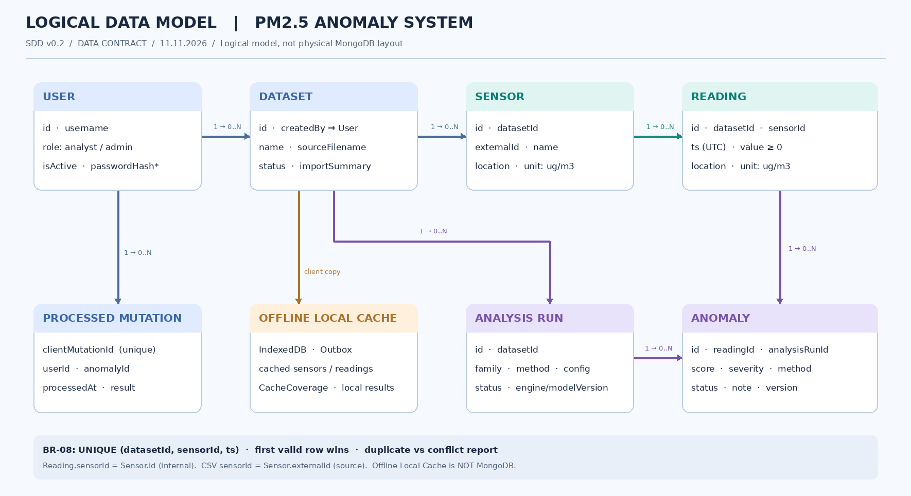

# Shared Data Contract v0.1 — PM2.5 Anomaly System

**Áp dụng:** `client/` (Tài + Duy), `server/` (Khiêm), `shared-core/` (Khải).  
**Nguồn:** SRS v0.4, SDD v0.1 Bước 1, kế hoạch thống nhất ngày 11/11/2026.  
**Trạng thái:** Hợp đồng dữ liệu **đề xuất để bắt đầu tích hợp**; nhóm trưởng và Khải cần review trước khi merge làm chuẩn. **Không phải OpenAPI / MongoDB schema vật lý cuối cùng.**

## A. Các quy ước chung (không tùy ý sửa)

1. **ID public:** chuỗi opaque không rỗng (`string`). Ví dụ `reading-001` chỉ là fixture; Backend được dùng `ObjectId` nội bộ nhưng API **không trả BSON**.
2. **Phép đo duy nhất:** PM2.5, trường `value`, đơn vị chuẩn `unit: "ug/m3"` (UI hiển thị `µg/m³`). Không nhầm ngưỡng anomaly với ngưỡng ô nhiễm/sức khỏe.
3. **Thời gian:** `ts`, `createdAt`, `updatedAt` truyền qua ranh giới module dưới dạng chuỗi **UTC ISO 8601 có `Z`**, ví dụ `2026-11-11T01:00:00.000Z`; DB có thể lưu `Date`. `timestamp` là tên trường ở CSV trước chuẩn hóa.
4. **Không gian:** GeoJSON Point `{ "type": "Point", "coordinates": [longitude, latitude] }` theo WGS84. Không hoán đổi kinh độ/vĩ độ. `longitude ∈ [-180,180]`, `latitude ∈ [-90,90]`.
5. **Tên trường:** DTO dùng camelCase (`datasetId`, `sensorId`, `analysisRunId`). Không lộ `_id`, `passwordHash`, `_v` hay document MongoDB vào UI.
6. **Định danh trạm:** `externalId` = mã `sensorId` **trong file gốc**; `Sensor.id` = ID nội bộ. `Reading.sensorId` luôn trỏ tới **Sensor.id**, không phải `externalId`.
7. **Tách nguồn phân tích:** `family: "statistical" | "ml"`; `method` thống kê thuộc `zscore | iqr | moving_avg`; tên ML cụ thể **chưa chốt**. `score` là điểm thuật toán, **không phải xác suất ô nhiễm**; độ lớn/chiều so sánh giữa các method không mặc nhiên tương đương.
8. **Review:** `status: "open" | "confirmed" | "false_positive"`; `version` là số nguyên dương, tăng khi review được lưu. Review không làm thay đổi score/method.
9. **Quyền:** role chỉ có `analyst | admin`; `admin` là quản trị ứng dụng. `passwordHash` chỉ tồn tại ở lớp persistence trên Server, không xuất khỏi API.
10. **Những field dấu `?`:** không bắt buộc (có thể vắng mặt); không tự xem `undefined`, `null` và chuỗi rỗng là tương đương.

## B. Quan hệ logic và tính toàn vẹn



Mở chỉnh sửa: [`diagrams/logical-data-model.drawio`](diagrams/logical-data-model.drawio).

| Quan hệ | Bội số | Khóa tham chiếu / quy tắc |
|---|---|---|
| User → Dataset | `1 : 0..N` | `Dataset.createdBy → User.id` |
| Dataset → Sensor | `1 : 0..N` | `Sensor.datasetId → Dataset.id`; trong một dataset `externalId` là duy nhất |
| Dataset → Reading | `1 : 0..N` | `Reading.datasetId → Dataset.id` |
| Sensor → Reading | `1 : 0..N` | `Reading.sensorId → Sensor.id`; Sensor và Reading phải cùng dataset |
| Dataset → AnalysisRun | `1 : 0..N` | `AnalysisRun.datasetId → Dataset.id` |
| AnalysisRun → Anomaly | `1 : 0..N` | `Anomaly.analysisRunId → AnalysisRun.id` |
| Reading → Anomaly | `1 : 0..N` | `Anomaly.readingId → Reading.id`; một Reading có thể được phát hiện ở nhiều lượt chạy |
| User → ProcessedMutation | `1 : 0..N` | `ProcessedMutation.userId → User.id`; `clientMutationId` phải duy nhất |
| Anomaly → ProcessedMutation | `1 : 0..N` | `ProcessedMutation.anomalyId` tham chiếu Anomaly đã tồn tại trên Server |
| Client Local Cache | Bản sao phạm vi | Không phải collection MongoDB. Chỉ chứa dữ liệu tải thành công, outbox và metadata phạm vi đã lưu. |

### Khóa logic và chính sách trùng BR-08 (đã chốt)

- Sensor được xác định duy nhất trong dataset theo `(datasetId, externalId)`.
- Reading được xác định duy nhất theo `(datasetId, sensorId, ts)` **sau chuẩn hóa** (`sensorId` ở đây là ID nội bộ); phải xử lý trùng cả trong file/batch và khi import lại.
- Chỉ **giữ reading hợp lệ đầu tiên** theo thứ tự tiếp nhận. Dòng sau có cùng khóa + cùng value chuẩn hóa → `DUPLICATE_SAME_VALUE`; cùng khóa + khác value → `DUPLICATE_VALUE_CONFLICT`; **không ghi đè**. Ghi nhận số dòng và vị trí dòng gốc.
- Một dataset khác được phép có cùng trạm nguồn và mốc đo mà không bị coi là trùng với dataset trước.
- Dataset chưa `imported` không được xuất hiện như dataset đã sẵn sàng trong truy vấn ứng dụng bình thường.

## C. Các đối tượng chia sẻ chính (DTO)

| Kiểu | Trường bắt buộc | Tùy chọn / ý nghĩa |
|---|---|---|
| **UserPublic** | `id`, `username`, `role`, `isActive` | Không có `passwordHash` |
| **Dataset** | `id`, `name`, `sourceFilename`, `status`, `createdBy`, `createdAt` | `importSummary` khi đã nhập; trạng thái vòng đời import là thiết kế dự kiến |
| **Sensor** | `id`, `datasetId`, `externalId`, `name`, `location`, `type:"pm25"`, `unit:"ug/m3"` | `region` |
| **Reading** | `id`, `datasetId`, `sensorId`, `ts`, `location`, `value`, `unit:"ug/m3"` | `location` truyền trong DTO để các renderer hiển thị trực tiếp; ở DB là dữ liệu tại trạm cố định |
| **AnalysisRun** | `id`, `datasetId`, `family`, `method`, `config`, `scope`, `status`, `createdAt` | `engineVersion`, `modelVersion`; `completedAt` khi terminal; `error:{code,message}` khi failed, không thông tin nội bộ |
| **Anomaly** | `id`, `datasetId`, `sensorId`, `readingId`, `analysisRunId`, `ts`, `location`, `family`, `method`, `score`, `severity`, `status`, `note`, `version`, `updatedAt` | Severity là nhãn tách khỏi score; quy tắc tính severity **chưa chốt** |
| **ImportSummary** | `totalRows`, `importedRows`, `duplicateRows`, `conflictingRows`, `invalidRows` | `issues[]` gồm số dòng, mã lỗi, dòng được giữ; đếm theo dòng đầu vào |
| **OfflineReviewMutation** | `clientMutationId`, `anomalyId`, `baseVersion`, `changes`, `createdAt` | `changes` chỉ gồm `status` / `note`, ít nhất một trường; ID dùng để retry cùng thao tác |
| **CacheCoverage** | `datasetId`, `cachedAt`, `storedReadingCount`, `complete` | `from`, `to`, `bbox`, `sensorIds`; `complete` chỉ đúng trong **phạm vi xác định**, không phải toàn bộ dataset |
| **DetectorInput / Output** | Phương pháp thống kê, mảng readings, cấu hình / kết quả flag-score | Input/Output thống kê có thể dùng đồng nhất ở Server và Web Worker |

Định nghĩa Zod/TS đi kèm: [`../shared-core/src/contracts/schemas.ts`](../shared-core/src/contracts/schemas.ts). **Không import MongoDB driver hoặc DOM** trong contract này.

### C.1. Các enum dự kiến của thiết kế

- Dataset `status`: `uploaded | awaiting_mapping | importing | imported | failed`. Đây là **quy ước triển khai đề xuất** để các module mock cùng một trạng thái; có thể điều chỉnh trước khi API Contract được duyệt.
- AnalysisRun `status`: `queued | running | completed | failed` (D008). `queued → running → completed/failed`, queued có thể failed trước thực thi; terminal không tự trở lại running. POST tiếp nhận trả snapshot queued, replay giữ snapshot; GET detail/history trả hiện tại. `scope` là snapshot sensorIds/from/to đã tiếp nhận, thiếu request scope chuẩn hóa `{}`; không lấy bộ lọc hiện tại để diễn giải run cũ. Completed nghĩa là toàn bộ kết quả đã lưu/đọc được; failed không công bố partial. `completedAt` là thời điểm terminal (kể cả failed); error chỉ có và bắt buộc khi failed. Danh mục mã lỗi detector và chính sách scope rỗng/biên thời gian còn cần chốt.
- `family = statistical | ml`; `method` khác nhau theo family. Zod ở bản khởi đầu chỉ kiểm tra method là chuỗi không rỗng; Backend/engine phải kiểm tra method được hỗ trợ tương ứng.
- Review status `open | confirmed | false_positive`; anomaly severity `low | medium | high`. **Chưa chốt** mapping score → severity (OPEN-04 SRS).

### C.2. Tại sao Reading có `location` dù Sensor đã có?

SRS yêu cầu bản đồ/Cube hiển thị trực tiếp theo vị trí. Ở **DTO trao đổi**, `Reading.location` giúp FE/Worker không phải gọi tra cứu Sensor cho mỗi điểm. Trong MongoDB vật lý, Backend có quyền **lưu dư vị trí hoặc resolve từ Sensor** tùy kế hoạch index. Hai cách phải sinh ra cùng một DTO và bảo đảm vị trí nhất quán vì trạm cố định. Không dùng DTO làm bằng chứng DB phải lưu trùng trường.

## D. Dữ liệu upload nguồn và normalized Reading là HAI hình dạng khác nhau

**Người dùng tải lên CSV/JSON** có `sensorId` mang nghĩa **external station code**, vị trí `latitude/longitude` dạng hai trường, `timestamp` có thể kèm offset, `unit` có thể là cột hoặc metadata mapping. Không đòi tên cột giống hợp đồng DTO ngay từ đầu.

```csv
station_id,lat,lon,observed_at,pm25,unit
S01,10.7769,106.7009,2026-11-11T08:00:00+07:00,25.5,ug/m3
```

**Sau xác nhận mapping + normalization**, backend tạo Sensor + Reading theo ví dụ chuẩn:

```json
{
  "id": "reading-001",
  "datasetId": "dataset-001",
  "sensorId": "sensor-001",
  "ts": "2026-11-11T01:00:00.000Z",
  "location": {"type": "Point", "coordinates": [106.7009, 10.7769]},
  "value": 25.5,
  "unit": "ug/m3"
}
```

- `timestamp` nguồn không timezone: **OPEN-02 SRS**, không âm thầm giả định UTC.
- Nếu nhiều dòng dùng cùng một `externalId` nhưng vị trí trạm không nhất quán: **chưa chốt chính sách xử lý**. Cần báo lỗi/review thay vì tự di chuyển trạm.
- **Không phát minh tọa độ** nếu dữ liệu công khai chỉ có tên trạm. Phải có nguồn tọa độ xác minh hoặc bước bổ sung trước khi dùng bản đồ.

## E. Hợp đồng giữa các nhóm

| Bên tạo → Bên dùng | Kiểu | Chủ trì / tác động |
|---|---|---|
| Khiêm Backend → Tài UI | `Dataset`, `Sensor`, `Reading`, `AnalysisRun`, `Anomaly` | Tài render mock từ `docs/fixtures/contract-example.json` trước khi API hoàn thiện |
| Khiêm Backend → Duy Offline | Cùng DTO + `CacheCoverage`, `OfflineReviewMutation` | Duy auto-cache theo những trang/tập thực sự đã tải, không coi toàn bộ dataset offline-ready |
| Khải engine → Khiêm Backend | `StatisticalDetectorInput`, `StatisticalDetectorOutput` | Backend gắn analysisRunId và lưu chỉ kết quả `flagged=true` thành Anomaly |
| Khải engine → Duy Web Worker | Cùng kiểu detector input/output | Đầu ra offline là **kết quả cục bộ**, không phải anomaly MongoDB có ID Server |
| Khiêm Backend → UI Review | `Anomaly` với `version`, `status`, `note` | Chỉ đổi review fields; kết quả thuật toán bất biến theo nghiệp vụ |
| Duy Offline → Khiêm Sync | `OfflineReviewMutation` | Server kiểm tra mutation ID và baseVersion; retry không áp dụng trùng |

**Quy tắc tách lớp:** Shared DTO là dữ liệu trao đổi; Backend mapping DTO ↔ MongoDB document, Duy mapping DTO ↔ IndexedDB, renderer chỉ dùng DTO. Không để enum hoặc timestamp format riêng trong mỗi module.

## F. Kịch bản hợp đồng phải test trước khi merge

1. `value=0` hợp lệ; `value=-1`, `NaN`, `Infinity`, lon `181`, lat `-91` phải bị từ chối.
2. GeoJSON `coordinates=[lon,lat]`; input timestamp có offset được normalize sang UTC `Z`.
3. Trùng reading sau chuẩn hóa, kể cả hai timestamp khác offset nhưng cùng UTC, vẫn được coi là trùng; báo cáo đúng BR-08.
4. Hai Dataset khác nhau có thể cùng `externalId` và `ts`.
5. Anomaly có thể cùng `readingId` nhưng **khác `analysisRunId`**.
6. `status` ngoài ba giá trị, `version` âm, `baseVersion` cũ bị từ chối/conflict; retry cùng mutation ID không cập nhật lần hai.
7. Auto-cache chỉ đánh dấu `complete=true` khi đã lưu toàn bộ **phạm vi xác định**; mất mạng giữa chừng lưu `complete=false`.
8. `viewer` không còn là role hợp lệ; `UserPublic` không được chứa `passwordHash`.
9. Detector thiếu dữ liệu / phương sai zero không sinh score `NaN` và không tạo anomaly giả.

## G. Những chỗ CÒN MỞ (không tự suy diễn thành quyết định đã chốt)

| Mục | Hệ quả | Cần chốt trước khi làm gì |
|---|---|---|
| SRS OPEN-02 — nguồn timestamp thiếu timezone | Bước mapping / normalization | Khóa validator import nguồn |
| SRS OPEN-03 — model ML và feature | ML runtime, metadata method | Chốt output ML + tích hợp Backend |
| SRS OPEN-04 — ngưỡng score → severity / detector defaults | UI legend, thống kê | Chốt detector config và giải thích severity |
| SRS OPEN-05 — giới hạn file & batch | Upload performance | Chốt ngưỡng từ kết quả thử nghiệm |
| SRS OPEN-06 / D008 — hướng async đã chốt | Còn concurrency, queue technology, retention/recovery và polling policy | Chốt trước triển khai B5/M5; không chặn scaffold hay Import |
| **NEW-01 — trạm cùng externalId khác tọa độ** | Sensor cố định / dữ liệu lỗi | Chốt chính sách khi xây import validation |
| **NEW-02 — status Dataset/AnalysisRun** | FE/Backend dùng cùng enum | Review enum dự thảo trước OpenAPI |
| **NEW-03 — metadata `CacheCoverage.complete`** | Tránh hiểu lầm toàn dataset đã lưu | Duy và Khiêm thống nhất độ hạt scope/pagination |

> **Quan trọng:** Bước 2 **chốt dữ liệu cốt lõi**, nhưng chưa chốt REST paths, mã HTTP, JSON envelope, field phân trang hay cấu trúc MongoDB tối ưu. Các nội dung đó thuộc Bước 3 API Contract / phần physical database tiếp theo.
